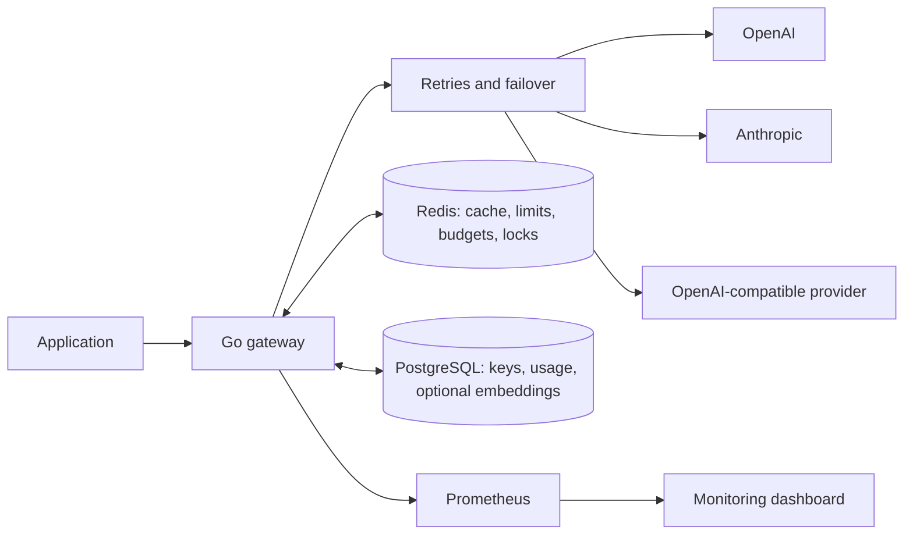
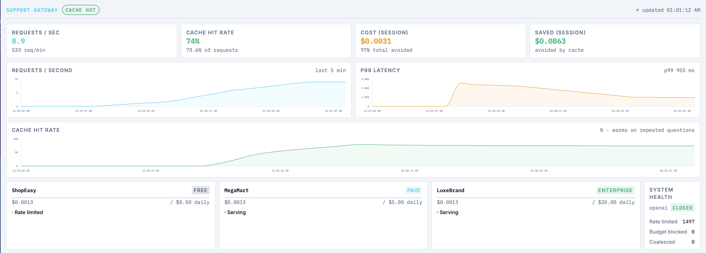

# LLM Serving Gateway

**One gateway to control LLM costs, reuse responses, and handle provider failures.**

LLM Serving Gateway sits between your application and providers such as OpenAI and Anthropic. Your app sends a chat request to the gateway; the gateway checks access and budgets, looks for a cached response, and calls a provider only when needed.

It exposes an OpenAI-compatible chat API, so supported clients can use it by changing their base URL, API key, and model name to a configured gateway alias.

```text
Your application → LLM Serving Gateway → OpenAI / Anthropic / local provider
                          │
                 Cache · Limits · Budgets
                 Failover · Usage tracking
```

## Why use it?

Without a shared gateway, each application has to manage provider credentials, retries, spending limits, and usage tracking itself. Repeated questions also lead to repeated paid calls.

This project puts those controls in one service. Each application gets its own gateway key and limits, while provider credentials stay on the gateway.

| Need | How the gateway helps |
|---|---|
| Spend less on repeated requests | Returns cached responses instead of calling the provider again |
| Keep one application from consuming the whole budget | Enforces per-key request rates and daily token/spend caps |
| Handle provider failures | Retries transient failures and tries configured backup providers |
| Avoid duplicate calls during traffic spikes | Coalesces identical requests already in flight |
| Understand usage and cost | Records tokens, spend, savings, latency, and provider choice |

## How a request works

1. **Check access.** Validate the application's gateway key and permitted model.
2. **Check limits and cache.** Apply rate limits and look for a reusable response. Exact-match caching is enabled for `temperature: 0` requests or explicit cache opt-in; semantic matching is optional.
3. **On a cache miss, reserve budget.** Check daily token and cost limits before sending paid work upstream. Over-budget requests receive `402`; rate-limited requests receive `429`.
4. **Call a healthy provider.** Share identical in-flight requests, then route through the configured provider chain with retries and circuit breakers.
5. **Return and account.** Return JSON or stream the response, cache completed eligible responses, settle usage, and queue the usage record for PostgreSQL.

For example, when an application repeats the same eligible request, the second response can come from Redis. If several identical requests arrive together before the cache is populated, coalescing reduces redundant provider calls.

## Architecture



- **Go** handles API requests, streaming, routing, and accounting.
- **Redis** holds shared request limits, budget reservations, response cache, and coalescing locks.
- **PostgreSQL** stores API keys and usage records, plus embeddings when semantic caching is enabled.
- **Prometheus and the dashboard** show traffic, latency, cache hits, spending, and provider health.

Usage records are written asynchronously in batches, keeping database inserts out of the response path. Circuit breakers track provider health within each gateway process.

[Explore the architecture →](docs/architecture.md)

## Reported benchmark results

The [benchmark report](docs/benchmarks.md) describes four runs against OpenAI `gpt-4o-mini`, using three support tenants and a repeated pool of ten questions.

| Metric | Reported result |
|---|---:|
| Requests submitted | 5,643 |
| Successful responses | 3,863 |
| Rate-limit rejections (`429`) | 1,780 |
| Unexpected client errors | 0 |
| Median latency | 5 ms |
| p99 latency | 828 ms |
| Provider spend | $0.0039 |
| Estimated spend avoided | $0.1003 |
| Cost savings for this workload | **96.9%** |

The workload deliberately repeats questions to exercise caching. Its savings depend on that repetition and should not be read as expected savings for every application. Rate-limit rejections are expected enforcement responses and are listed separately from successful requests. These results do not establish maximum sustainable throughput.

The report also documents provider outage, latency, and recovery checks. Automatic failover requires backup providers in the route; if every provider fails, the gateway can still return an error.

[Read the methodology and reliability results →](docs/benchmarks.md)

## Try it locally

You need Docker with Compose and an OpenAI API key. The current default route uses the live OpenAI API, so uncached requests can incur provider charges.

From the repository root, create the local secrets file:

```sh
export ADMIN_API_KEY="$(openssl rand -hex 32)"
read -s OPENAI_API_KEY
export OPENAI_API_KEY
printf 'ADMIN_API_KEY=%s\nOPENAI_API_KEY=%s\n' \
  "$ADMIN_API_KEY" "$OPENAI_API_KEY" > deploy/.env
chmod 600 deploy/.env
```

Start the stack and check readiness:

```sh
docker compose --env-file deploy/.env -f deploy/docker-compose.yml up --build -d
curl http://localhost:8080/readyz
```

Create an application key with a 60-request/minute limit and a $5 daily cost cap:

```sh
curl http://localhost:8080/admin/keys \
  -H "Authorization: Bearer $ADMIN_API_KEY" \
  -H 'Content-Type: application/json' \
  -d '{"name":"my-app","rpm_limit":60,"daily_cost_micros":5000000}'
```

Copy the returned `key` into `GATEWAY_API_KEY`, then send a request:

```sh
export GATEWAY_API_KEY='paste-the-returned-key'

curl -i http://localhost:8080/v1/chat/completions \
  -H "Authorization: Bearer $GATEWAY_API_KEY" \
  -H 'Content-Type: application/json' \
  -d '{"model":"support","messages":[{"role":"user","content":"What is your return policy?"}],"temperature":0,"max_tokens":64}'
```

Repeat the request and inspect `X-Cache`. Add `"stream": true` and use `curl -N` to try streaming.

For an OpenAI-compatible SDK, use `http://localhost:8080/v1` as the base URL, the returned gateway key as the API key, and `support` as the model alias. The default configuration currently has one provider; add a backup in `config/models.yaml` to enable failover.

### View the dashboard

Open **[localhost:8888](http://localhost:8888)**. Enter your admin API key and keep the pre-filled gateway and Prometheus URLs. The dashboard shows request traffic, cache behavior, latency, and cost.



## Where to go next

| Guide | What it covers |
|---|---|
| [Deployment](docs/deployment.md) | Provider configuration, application keys, model tiers, and admin API |
| [Architecture](docs/architecture.md) | Components, shared state, and request flow |
| [Benchmarks](docs/benchmarks.md) | Workload, results, and reliability checks |
| [Model configuration](config/models.yaml) | Model aliases, provider order, and configured prices |

For a deployment beyond local development, review secret management, network access, persistence, and accounting limitations before relying on the gateway for production traffic.
