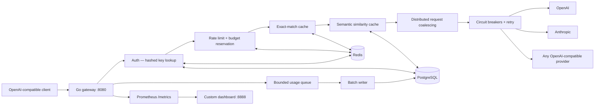

# Architecture

## Overview

The gateway sits between your application and LLM providers. Applications authenticate with a scoped gateway key; the gateway enforces limits, manages caching and failover, and writes metering records — without any changes to application code.

## Request flow

Each request passes left to right through every stage before a provider is called. Stages that produce a response (cache hits, rate limit rejections, budget blocks) short-circuit the rest of the chain.

## Components

### Authentication

Every request must carry a `Bearer` token. The gateway hashes it (SHA-256) and looks up the matching row in PostgreSQL. Lookups are cached in Redis for 30 seconds, so short database outages do not take down serving. Revoked keys are evicted from Redis immediately on deletion.

The admin key (`ADMIN_API_KEY`) is separate from application keys. It is checked by header comparison, not stored in the database.

### Rate limiting and budget reservation

Rate limits and daily cost budgets are enforced atomically across all gateway replicas using Lua scripts in Redis, so a limit set to 60 RPM is 60 RPM across the whole fleet, not 60 RPM per instance.

Budget reservation is conservative: the gateway reserves `input_bytes` tokens plus the key's configured `daily_tokens` output allowance before forwarding the request. The actual cost is settled after the provider responds. If the actual usage is lower, the difference is returned to the budget. This prevents overspend without requiring a round-trip to the provider first.

### Exact-match cache

Completed responses are stored in Redis keyed by a SHA-256 hash of the canonical request (model alias + sorted messages + temperature + max\_tokens). On a cache hit the response is replayed in full, including streaming, with `X-Cache: hit` and sub-millisecond latency.

Cache is enabled when `temperature` is `0` or the request carries `X-Cache: force`. It can be bypassed per-request with `X-Cache: bypass`. TTL is set per API key (default 24 hours).

### Semantic similarity cache

When an exact cache miss occurs and an embedding service is configured (`EMBEDDING_URL`), the gateway embeds the user message and queries PostgreSQL for stored embeddings with cosine similarity above a configurable threshold (default 0.95). A match returns the stored response as if it were an exact hit.

Embeddings are stored in a `semantic_cache` table as PostgreSQL JSONB arrays. The similarity calculation runs in SQL using a dot-product function.

### Distributed request coalescing

If two identical requests arrive while the first is still in flight, only one is forwarded to the provider. The second request waits on a Redis pub/sub channel and receives the same response when the first completes. This eliminates redundant provider calls during cache warm-up bursts.

### Circuit breakers and routing

Each provider has a process-local circuit breaker tracking the last 20 results. The circuit opens after 5 consecutive timeouts or when more than 50% of the window is failures. An open circuit blocks calls to that provider for 30 seconds, then allows one probe request. If the probe succeeds, the circuit closes.

The router tries providers in the order listed in `config/models.yaml`. On a transient error (429, 5xx, timeout) it retries once on the same provider, then falls back to the next entry. If all providers are exhausted, it returns 502.

Hedged requests (when two or more providers are healthy) send to the top two simultaneously; the first response wins and the slower call is cancelled.

### Usage metering

After each completed request the gateway enqueues a usage record to a bounded in-memory channel. A background goroutine drains the channel in transactional batches to PostgreSQL. The batch writer never blocks the request path; if the channel is full, records are dropped rather than slowing serving.

Each record stores: request ID, API key ID, model alias, provider, input/output tokens, cost, saved cost (cache value), provider latency, gateway overhead, and timestamp. Message content is never stored.

### Observability

The gateway exposes Prometheus metrics at `/metrics`. Key counters and histograms:

| Metric | Type | Description |
|---|---|---|
| `gateway_requests_total` | Counter | Labelled by provider, model, cache\_status, status\_code |
| `gateway_request_duration_seconds` | Histogram | Full end-to-end latency |
| `gateway_cost_usd_total` | Counter | Cumulative spend forwarded to providers |
| `gateway_saved_usd_total` | Counter | Cumulative spend avoided by cache |
| `gateway_ratelimited_total` | Counter | Requests rejected by rate limiter |
| `gateway_budget_rejected_total` | Counter | Requests rejected by budget enforcement |
| `gateway_coalesced_total` | Counter | Requests that waited on an in-flight duplicate |
| `gateway_failovers_total` | Counter | Provider failover events |
| `gateway_breaker_state` | Gauge | Per-provider circuit breaker state (0=closed, 1=open, 2=probe) |

Response headers on every request: `X-Cache`, `X-Provider`, `X-Gateway-Overhead-Ms`, `X-RateLimit-Remaining`, `X-Request-ID`. On streaming responses, `X-Provider` and the final `X-Gateway-Overhead-Ms` arrive as HTTP trailers.

The Compose stack includes a custom monitoring dashboard (nginx, port 8888) that polls Prometheus and the admin usage API. No Grafana or external service is required.

## State distribution

| State | Where | Scope |
|---|---|---|
| API key metadata | PostgreSQL (source of truth) + Redis (30s cache) | All replicas |
| Rate limit token buckets | Redis | All replicas |
| Daily budget reservations | Redis | All replicas |
| Exact-match cache entries | Redis | All replicas |
| Semantic cache embeddings | PostgreSQL | All replicas |
| In-flight coalescing lock | Redis pub/sub | All replicas |
| Circuit breaker state | Process memory | Per replica |
| In-flight request deduplication | Process memory | Per replica |
| Usage records | PostgreSQL | Durable |

Circuit breakers and in-flight deduplication are process-local by design: they track live connection state that does not need to be shared, and sharing it would add latency on the hot path.
